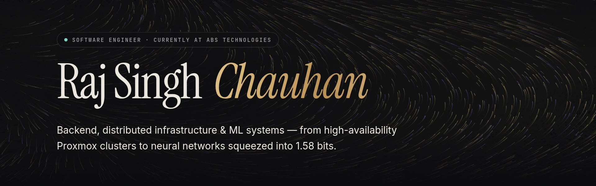

<!--
  Hello, source reader. You found the first one.
  There are eight more on https://rajchauhan28.online. Start by pressing the backtick key.
-->

  
  
  
  
  

I build systems that live close to the metal and stay up. My work sits where backend engineering, distributed infrastructure and ML inference meet. Right now that means a multi-site virtual-desktop platform on Proxmox VE, and vision models compressed to 1.58 bits so they run on a Raspberry Pi. In between, I write tools for my own Linux desktop in Rust, Python and QML.

### Now

- **Software Developer, Infrastructure & Virtualization** at **ABS Technologies** (May 2026 – present). I run a multi-site VDI on Proxmox VE with Corosync quorum, HA failover and cross-node replication, backed up through Proxmox Backup Server to AWS.
- **First author of NanoBit**, published in the IET Conference Proceedings (ICRACS 2026).
- **B.Tech, Computer Science**, Amity University Rajasthan (2022 – 2026).

Previously: led a four-person backend team at Bluestock Fintech (Django, PostgreSQL, ~20% lower API latency), and audited AI-generated Python and SQL at Outlier.ai.

### Research

**[NanoBit: Extreme Compression for Vision Architectures via 1.58-Bit Ternary Quantisation](https://digital-library.theiet.org/doi/10.1049/icp.2026.4002)** 
IET Conference Proceedings · ICRACS 2026 · first author · DOI 10.1049/icp.2026.4002

A hybrid-precision vision model: ternary weights `{−1, 0, +1}` in the pointwise layers, FP32 in the spatial ones. A Rust bit-packing kernel and a C++ inference engine run it on a Raspberry Pi 5.

| 10.7× smaller | 82.83 % top-1 | 6.7× faster | > 20× less memory |
|:--:|:--:|:--:|:--:|
| 106.8 → 9.98 MB | ImageNette-320 | Pi 5 · 3.13 FPS | < 100 MB vs > 2 GB |

### Open source

| Project | What it is |
|:--|:--|
| [**hypr-dotfiles**](https://github.com/rajchauhan28/hypr-dotfiles) | My Hyprland desktop, plus one-command provisioning that cut machine setup from ~2.5 hours to under 30 minutes. QML · Bash |
| [**auralink**](https://github.com/rajchauhan28/auralink) | A fast Wi-Fi, VPN and Bluetooth manager for Linux, with live Pywal sync. Rust · Slint |
| [**WallLust**](https://github.com/rajchauhan28/WallLust) | Wallpaper daemon and GUI for Wayland/Hyprland: smooth transitions, mpv video wallpapers, Pywal colours. Rust |
| [**redragon-mouse-linux**](https://github.com/rajchauhan28/redragon-mouse-linux) | Userspace driver, CLI and Qt GUI for the Redragon M693 wireless mouse: DPI, RGB, macros, battery. Python |
| [**archClean**](https://github.com/rajchauhan28/archClean) | Safe Arch Linux cleanup: caches, orphans and disk usage, with a confirmation before anything is removed. Python |

### Toolkit

**Languages & backend** · Python, Rust, C++, Bash, SQL, Django, PostgreSQL, REST APIs 
**Infrastructure** · Linux, Proxmox VE, Proxmox Backup Server, HA clustering, AWS, Oracle Cloud, Docker, CI/CD 
**ML & inference** · PyTorch, Triton, Hugging Face Transformers, INT8 / 4-bit / 1.58-bit quantization

### Honours

1st, WhackHackathon 2024 (Amity University) · Finalist, IIT Delhi Techfest (Syntaize AI) · 1st, Robo Race 
OCI Generative AI Professional (2025) · Amazon ML Summer School (2024) · [HackerRank 5★ Python](https://www.hackerrank.com/profile/rajsinghchauhan1)

 

<code>w ∈ {−1, 0, +1}</code> · psst, <a href="https://rajchauhan28.online">the website</a> hides eight secrets. Start with <kbd>&#96;</kbd>

